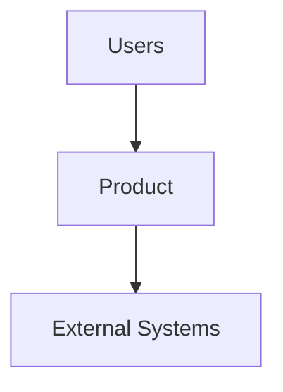

# PrecodeOS — Architecture Template
<!-- ANCHOR: architecture -->

> AUTHORITY: Route structure, flow shape, module placement, and auth boundaries for the target project.
> NOT_AUTHORITY: Business scope, pricing policy, feature prioritization, or field-level schema semantics.
> LOAD_WHEN: Planning or reviewing architecture-affecting work.
> CLASS: reference

Creator: Dan Sears / Recode
Document version: v0.1.1
Last updated: 2026-09-06

## Architecture

Add target-project architecture notes here.

### Core Pull Request Integration Boundary

For PrecodeOS package work, the core flow is `Idea -> Brief -> Packet -> Intake -> PRD -> Architecture? -> Bead -> Branch/Worktree -> Change -> PR -> Proof -> Review -> Close -> Merge/Re-entry -> Release`. A pull request is the provider-neutral proposed integration record for a change developed in an isolated branch or worktree. It connects the bead, primary authority, changed files, proof, review, closeout, and integration decision. GitHub is an external evidence surface for this contract; PR state does not accept implementation, approve merge or release, choose work, activate beads, or promote owner-file truth.

### Optional Mermaid Views

When diagrams clarify a real decision, keep them separate and focused:

Use a system-context view for users, the product boundary, and external systems; a container view for frontend, API, services, data, queues, and providers; and a detailed sequence or state view for one interaction or lifecycle. Link each diagram to the durable decision it explains. The diagram remains explanatory evidence; architecture, API, data, security, and acceptance facts belong in their owning files.

Do not create one enormous diagram, include secrets or unsupported implementation claims, or assume Mermaid rendering is available in every host. If prose or a table is clearer, use that instead.

## Risk-Triggered Production-Readiness Guidance

Use this section only when an approved PRD identifies system-boundary, multi-system, dependency, environment, state-flow, or recovery risk. Record the chosen boundary, source of truth, failure behavior, recovery or blocked escape, and durable decision. Keep low-risk work light; do not turn this template into a universal architecture checklist or treat its completion as production-readiness certification.
